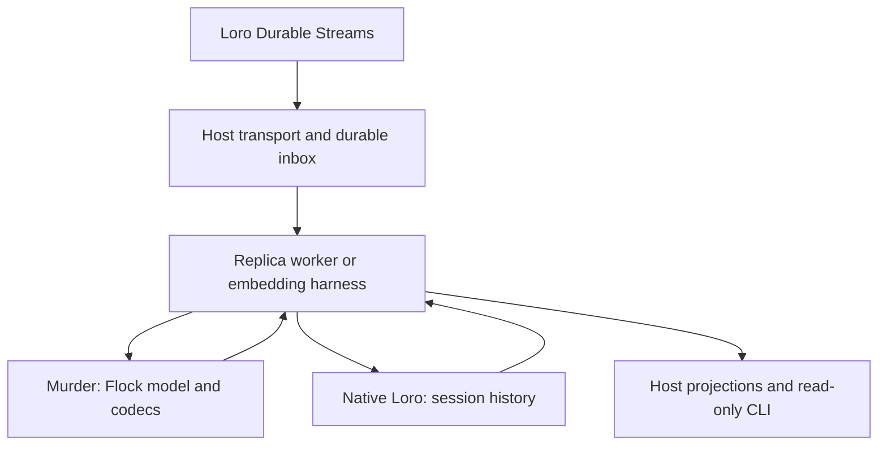

# Murder technical design

- **Status:** Proposed; no runtime implementation or compatibility
  qualification.
- **Updated:** 20 November 2026.
- **Audience:** Murder implementers and maintainers of Youxia's replica workers.
- **Companions:** [Replica boundary](contracts/replica-boundary.md),
  [fixture manifest schema](contracts/fixture-manifest.schema.json), and
  [GIST roadmap](roadmap.md).

## 1. Purpose and outcomes

Murder will implement Lody's Flock model and wire formats in a native Rust
library. Flock is a conflict-free replicated data type (CRDT): a map of
last-writer-wins (LWW) registers. Lody carries Flock snapshots and deltas over
Loro Durable Streams, alongside other document families.[^1] Sharing that
transport does not make Flock a `LoroDoc`. Its tuple keys, clocks, tombstones,
and serialization need their own implementation.[^2][^3]

The first deliverable is a bounded native reader that imports upstream binary
snapshots and JSON deltas, merges them, and exposes queryable state with
explicit progress and failure. A second slice makes that reader recoverable
inside a host. Later slices add qualified authoring and publication. Each slice
must publish its supported profile and evidence before a consumer can advertise
compatibility.

The product goal is to unblock Youxiad's read-only observation and, later,
durable metadata writes. The scope needs care: named Flock documents and the
workspace session-metadata store use separate streams. The documented metadata
catalogue does not establish that store's internal merge or wire format.[^4]
Murder's Flock reader therefore supplies a qualified component; it does not
alone qualify Youxia's complete session catalogue.

Youxia's proposed architecture places Murder in isolated replica workers and
reserves transport, credentials, durable storage, and scheduling for the
daemon. Its early `arun` experiment uses an application-owned Agent Client
Protocol (ACP) host port and an SDK adapter.[^5] Youxia will add a Magitek
adapter after qualifying it against the same application contract.[^6] Neither
ACP implementation belongs in Murder's dependency graph.

Success means three independently reviewable outcomes:

1. A native reader agrees with independently generated upstream fixtures for
   its declared profile, including compacted streams that need snapshots.
2. A host can recover that replica after interruption without losing covered
   records, presenting a partial catalogue as current, or publishing remotely
   from a read-only connection.
3. A later writer retains exact committed mutations and interoperates with
   the selected upstream profile without reusing ambiguous clocks or hiding
   unsupported behaviour.

## 2. Evidence and compatibility profiles

### 2.1. Pinned baseline

The protocol baseline is `leynos/lody-docs` at
`fce1be8092f7db763598e986fc96288fe94302c8`. It records an inspection of
`LodyAI/Lody` at `61bd9701a5ed6899a9f42787df682acfc3fd7d4b` and the published
packages `@loro-dev/flock-wasm` 0.5.0, `loro-repo` 0.25.0, and
`@loro-dev/streams-crdt` 0.20.0. Its findings come from source/package reading
and finite models; they do not verify a running service.[^1][^7]

The consumer alignment uses Youxia PR 12 at
`284127edaf6b78e9db7a504dc4215c7ac5ef016f` and Magitek PR 14 at
`21ba7adb81e022f2700cd5a8ab17b2147aa5936b`. Both remain proposals at this
document's date. Their task identifiers describe integration targets, not
merged APIs or completed work.[^5][^6]

Keep four kinds of evidence separate, as Table 1 specifies.

| Profile            | Evidence required                                                                         | Claim it permits                                   |
| ------------------ | ----------------------------------------------------------------------------------------- | -------------------------------------------------- |
| Wire profile       | Recovered format rules, pinned oracle and fixtures, supported cases and exclusions        | Native import/export for those bytes and semantics |
| Library profile    | Native conformance, fault behaviour, and measured resource limits                         | A qualified library capability under those limits  |
| Consumer profile   | Adapter, transaction, worker-recovery, and projection checks                              | Correct embedding in that consumer                 |
| Deployment profile | Captured stream naming, authentication, framing, retention, snapshot and server behaviour | Compatibility with that deployment                 |

_Table 1: Compatibility claims and their required evidence._

### 2.2. Resolve gaps before claiming support

The source evidence leaves exact tuple encoding/order, binary snapshot grammar,
JSON bundle edge cases, number and clock ranges, peer comparison details, and
local clock allocation unresolved.[^2][^3][^7] Recover and document these from
available source and executable reference behaviour. Record licence and
redistribution rights for implementation material and fixtures. Do not assume
that a reusable native implementation exists or that a familiar hybrid-clock
algorithm matches Flock.

An unsupported format is an explicit error or an explicitly excluded profile
case. A partial decoder must not become an apparent empty catalogue. If a
required format cannot be established, report the blocked capability while
continuing independent host and ACP work against contract fakes.

The [manifest schema](contracts/fixture-manifest.schema.json) describes corpus
records; it does not describe Flock's wire format. Its
[planned example](contracts/fixture-manifest.example.json) records the pins
without inventing fixture bytes. A future semantic validator must verify unique
case identifiers, contained paths, actual digests, generator and lockfile
identity, licence/sanitization evidence, independently produced expected
results, and the profile's mandatory case inventory. Schema validity alone
establishes none of those facts.

## 3. Architecture and ownership

Start with one Rust library, synchronous concrete APIs, and internal modules
for model, codecs, and optional synchronization policy. A consumer can place
the library in a worker process; a standalone embedding harness can call the
same boundary. A separate crate for every concept would add release and API
coordination before a second consumer needs it.

Figure 1 shows how the host supplies Flock input and receives bounded changes.
Native Loro owns session history through its own boundary.

_Figure 1: Flock and Loro share host infrastructure while retaining distinct
native models and codecs. The embedding harness can replace the production host
for library qualification._

The [replica boundary](contracts/replica-boundary.md) defines semantic values
and operations before Rust signatures stabilize. Table 2 assigns ownership.

| Component            | Owns                                                                                                   | Excludes                                              |
| -------------------- | ------------------------------------------------------------------------------------------------------ | ----------------------------------------------------- |
| Murder model         | Tuple keys, clocks, entries, tombstones, merge, queries, version summaries, bounded changes            | Session scheduling, row authority, Loro history       |
| Murder codecs        | Qualified snapshot/delta decoding and later encoding; admission and format errors                      | Streams HTTP, credentials, service retention promises |
| Optional sync policy | Deterministic bootstrap/resume and later upload decisions from supplied events                         | I/O, background tasks, database and retry services    |
| Host adapter         | Stream identity, generation, transport, exact journal, cursors, transactions, worker lifetime, budgets | Reimplementing Flock conflict resolution              |
| Host projection      | Typed row validation, application indexes, command eligibility, outward events                         | Treating a row or import as execution authority       |

_Table 2: Ownership at the library boundary._

Remote bytes, row values, clocks, and claimed identities cross an untrusted
input boundary. Murder validates format and resource limits; the host
authenticates stream access and applies application authorization. Read-only
capabilities must prevent outgoing effects in both layers. A compromised row
must not acquire command authority merely because it merged successfully.

Production use requires neither Node.js, WebAssembly, an async runtime, nor a
Loro CRDT engine inside Murder. Development may use the pinned upstream package
as an oracle to generate fixtures; ordinary native replay runs offline against
those recorded artefacts. This separates reference availability from the
production dependency graph.

## 4. Data model and codecs

### 4.1. Registers, keys, and versions

A supported entry contains an ordered tuple key, a whole JSON value or an
explicit tombstone, and `(physicalTime, logicalCounter, peerId)`. Compare
clocks in that order. Merge resolves each key independently; concurrent edits
to different fields of one row do not combine. A tombstone has no data and must
remain distinct from a JSON `null` value. Deleting an absent or already deleted
key is a no-op in the upstream contract.[^2]

Qualify key type ordering, nested JSON treatment, numeric precision, Unicode
ordering, and peer comparison against the selected profile. Do not inherit Rust
string or `serde_json` behaviour without checking it. Generic state preserves
supported unknown row families and fields. Host projections may reject
malformed known rows, including a value whose embedded identifier disagrees
with its key, without deleting the underlying replicated entry.[^2]

Merge convergence requires identical entries for any one key and equal clock.
The initial defensive policy rejects or quarantines differing values or
tombstones for that same key and clock; it does not invent a tie-breaker.
Record this policy and any divergence from reference behaviour in the profile.
Do not infer an unverified global prohibition on different keys sharing a
clock. The convergence claim covers admitted, unambiguous entries only.[^2]

Expose `version()` and `inclusiveVersion()` with the upstream distinction: the
former summarizes visible entries by peer; the latter also accounts for
overwritten peers. Preserve whatever metadata the qualified profile needs.
Neither summary proves that every lower-clock entry exists locally.[^2][^3]

### 4.2. Import, query, and change semantics

The reader needs both upstream binary `exportFile()` snapshots and JSON
`exportJson(fromVersion)` deltas. It need not export either format yet. The
host supplies a complete admitted payload with its profile and replica binding.
Murder reserves decode/staging capacity, validates it, and installs the result
atomically from a caller's perspective. Malformed or over-budget input leaves
visible state unchanged. If a worker dies during installation, the host
discards that instance and rebuilds before exposing another result.

Return bounded changes with source provenance and a local revision. Preserve
the observable per-commit batch semantics; reproducing JavaScript callback
scheduling is unnecessary. A local batch is not a transaction across replicas.
Versioned query pages must refer to one revision or report invalidation. A
consumer cannot silently combine pages from before and after an import.[^2]

Typed errors distinguish malformed data, unsupported profile/version, same-key
equal-clock conflict, resource exhaustion, stale generation, and history gaps.
The host adds storage and transport failures. A valid duplicate can report no
change; a failed import cannot. Do not collapse either result into a durability
acknowledgement.

## 5. The initial read-only slice

### 5.1. Useful reader, explicit authority

The offline slice replays a snapshot plus JSON tail, or a verified complete
log, into a native replica and exposes exact-key/prefix queries, tombstones,
both version summaries, and bounded changes. Include Machine Flock and
Workspace Flock examples. The minimum useful reader handles compacted streams;
a JSON-only implementation remains a development increment.

The connected observer adds bootstrap, resume, and gap detection through
host-supplied records. Upstream bootstrap takes a snapshot if available, then
the retained tail. Its ordinary initial join also uploads local entries beyond
the server's lower-bound version, including on resume.[^3] Murder's observer
must suppress that path even when a restored replica is ahead of the server.

The read-only capability provides no local authoring or publication authority.
It cannot append, create/delete a stream, publish a snapshot, upload through
the local data plane, announce presence, claim work, change read status, or
answer permissions. Imports and durable local caches remain permitted.
Transport spies and a host capability boundary must witness zero remote
mutations across fresh bootstrap, resume, reconnect, and ahead-of-server
restore. No `put` call is an insufficient test of this property.

### 5.2. Scope and completeness

The source distinguishes the stream families in Table 3.[^2][^4]

| Data                                         | Stream identifier                   | Murder's initial responsibility                                                 |
| -------------------------------------------- | ----------------------------------- | ------------------------------------------------------------------------------- |
| Machine Flock                                | `<workspaceId>:mf:<machineId>`      | Generic native Flock import and reads                                           |
| Workspace Flock                              | `<workspaceId>:wf:workspace`        | Generic import; host interprets roles, servers, and projects                    |
| Session/machine metadata and existence index | `<workspaceId>:meta`                | Unresolved representation; qualify separately before assigning a Murder adapter |
| Session history                              | `<workspaceId>:s:<sessionId>`       | Native Loro worker, outside Murder                                              |
| Schedule registry and collaboration indexes  | `:sr`, `:fi:`, and `:fis:` families | Additional profiles and consumer scope, deferred                                |

_Table 3: Stream families relevant to Youxiad observation._

Every host query carries evidence status: partial bootstrap, current through a
declared boundary, stale, unsupported, or blocked. A successful local scan does
not prove the absence of later cloud records. Distinguish no route, joined, and
caught up; upstream zero-transport success must not become proof of confirmed
synchronization.[^3][^7]

A missing required snapshot or uncovered retained history is a gap. A stream
with a complete retained log can bootstrap without a snapshot. Reset or
rebootstrap only after replacement coverage qualifies. Youxia's
watch-before-list catalogue and shadow-observer checks remain consumer
obligations; Murder does not decide that a session exists or that its whole
history is available.

## 6. Durability and recovery

Bind source records and checkpoints to stream identity, replica lineage, owner
generation, format profile, and exact retained input. Treat offsets as opaque
positions interpreted by the qualified host transport. Imported state alone
proves no durability. The upstream invariant requires the recoverable data
before its covering durable cursor.[^3]

Two embeddings satisfy that invariant. A host can apply a record, durably
retain its recoverable representation, and then save the cursor. Youxia's
proposed inbox instead atomically saves exact raw bytes with a contiguous
received cursor, then separately commits applied projection/events. This works
only when a known baseline and the retained suffix reconstruct native state.
Table 4 keeps their evidence distinct.[^5]

| Position             | What it establishes                                                         | What it cannot establish                                     |
| -------------------- | --------------------------------------------------------------------------- | ------------------------------------------------------------ |
| Received             | Bytes reached the host                                                      | Recovery after failure                                       |
| Durably recoverable  | A committed baseline and exact retained prefix cover the cursor             | Successful decoding or current visible rows                  |
| Applied/projected    | Native imports and the committed application projection cover that position | Remote acceptance of local writes                            |
| Server/peer evidence | The named remote party acknowledged a defined operation or boundary         | Every peer's state, command execution, or global convergence |

_Table 4: Progress positions and their limits._

On replacement, a replica worker must import all records needed to reconstruct
its own state even if a surviving projection records a later watermark. Use
that watermark to suppress duplicate outward events, not to skip native
reconstruction. Reject old-generation callbacks and foreign checkpoints.
Durably quarantined invalid input stops applied progress; it does not make an
incomplete room current. No consumer may use Loro-specific pending-operation
metadata as a substitute for Flock's retained entries and records.

Keep the version-hole counterexample executable: peer P's clock-20 entry at key
A is present, but its clock-10 entry at key B is missing. Both replicas can
report maximum 20 while disagreeing; a delta requested from 20 cannot repair B.
Pruning on vector equality therefore loses information. The local data plane
does not repair this class of hole.[^3][^7]

Only prune records when a committed checkpoint, or retained upstream snapshot
and suffix, proves equivalent recovery coverage for this lineage and profile.
The first reader can retain upstream snapshots and exact deltas without a
native checkpoint format. A later checkpoint needs its own version, digest,
atomic replacement, migration/rebuild policy, and recovery qualification.

## 7. Authoring and synchronization

### 7.1. Durable prepared mutations

Authoring follows reader qualification, not completion of Youxia or Magitek.
First establish the exact local clock rule, including explicit timestamps,
backward time, future-clock imports, same-millisecond edits, restart, and
overflow. The source's assumption that local writes outrank superseded entries
does not supply that algorithm.[^2]

The later writer prepares exact entries, encoded bytes, next clock state, base
revision, and a stable operation identity without changing visible state. The
host serializes imports and edits from preparation through durable disposition
and installation, checks the base revision before commit, and commits the
prepared result with durable peer identity and outbox records. Only committed
mutations can install or become eligible for publication.

A confirmed rollback discards the preparation. An indeterminate commit or lost
acknowledgement blocks further authoring until the host reconciles the stable
operation identity with durable storage. It cannot reuse that clock for
different bytes. A crash after commit but before installation replays the
committed mutation. If the engine cannot support preparation, revise the
contract explicitly: a failed durable operation must invalidate and rebuild the
mutated instance before further use.

The generic `put` contract and a typed writer's no-op suppression are distinct.
Lody's typed row writer avoids re-authoring unchanged command state; do not
apply that optimization to every generic `put` without upstream evidence.
Multi-row commits group local changes, events, and durable records, while
remote merges still resolve each key separately.[^2]

### 7.2. Publication and retry

Murder may expose deterministic synchronization decisions; the host owns
transport attempts, retry timers, and durable outbox execution. Retries use the
committed bytes and producer identity. Record local commit, attempted delivery,
confirmed server acceptance, and peer observation separately. None proves
exactly-once command execution.

A synchronization attempt captures a dirty generation and can clear only that
generation after a qualifying result. A new edit during the attempt remains
pending. Restart reconstructs pending work from durable records; an in-memory
dirty flag cannot do so. No-route and unconfirmed results retain pending state.
Liveness additionally needs eventual connectivity and fair retry, which the host
supplies.[^8]

JSON delta export and binary snapshot export are separately qualified
capabilities. Snapshot import remains available without either. Local peer
transports, server retention, and snapshot publication require their own
integration evidence. Tombstones cannot be collected on local age alone.

Command interpretation stays with Youxia. A later write can resurrect a deleted
row; permanent cancellation rows express different semantics. Murder must
preserve those rows without inventing a stronger deletion guarantee or
automatically acting on provider/setup commands.[^9]

## 8. Resource limits and observability

An encoded-byte cap alone does not bound native memory. Admission must account
for decoded entries, key/value depth and size, tombstones, peer/version state,
staging beside the old replica, returned changes, query results retained by the
caller, and queued work. Limits belong to the published library profile; the
host additionally accounts for transport framing, decompression if it owns that
layer, disk spools, and worker queues. Identify compression ownership when
recovering the format; charge its expansion before admitting decoded objects.

Reserve bounded staging and output capacity before installation. Avoid an
admission rule that requires an oversized record to acquire an impossible
permit while holding the only path that could free capacity. The host can spool
bounded descriptors to disk or reject/quarantine input explicitly. Retention of
borrowed or owned results must consume a budget; returning a handle does not
make its memory free. Test snapshot replacement with both old and staged state
live.

Synchronous decoding need not become cooperatively cancellable. Youxia can
enforce deadlines with a killable replica process and discard interrupted
state; moving a blocking call to a thread alone does not establish bounded
latency. Never hold a database transaction while waiting on an arbitrary caller
or network round trip.[^5]

Qualification workloads must fit the initial shared continuous-integration (CI)
target of at most four virtual CPUs and 8 GiB of memory. This is a test budget,
not a measured performance claim. Record fixture dimensions, native peak
memory, allocated limits, elapsed time, and failure behaviour before choosing
default operational caps. Larger deployment workloads belong to the consumer
qualification, not a prerequisite for every library change.

Expose import duration/bytes, admitted/rejected entries, replica and staging
memory, retained tombstones, replay depth, and failure reason through bounded
statistics or host callbacks. The host exposes cursor lag, oldest pending
record, gaps, and no-route state. Keep arbitrary keys, values, peer IDs, and
stream names out of metric labels and routine logs; they can leak replicated
content and create unbounded cardinality. Operators need the profile,
generation, and diagnostic category to understand a blocked room.

## 9. Validation obligations

### 9.1. Named properties and discriminating witnesses

The implementation tasks must establish the properties in Table 5. Each row
names a failure the evidence must distinguish. A report records the Murder
revision, reference profile, cases, commands, results, and exclusions.

| ID and invariant                                           | Required method and witness                                                                                                                                                           | Scope and remaining limit                                                                                  |
| ---------------------------------------------------------- | ------------------------------------------------------------------------------------------------------------------------------------------------------------------------------------- | ---------------------------------------------------------------------------------------------------------- |
| V1: Native interpretation agrees with the selected profile | Independent upstream snapshot/delta fixtures, including empty/tombstone/null, tuple types, clock ties, Unicode/numeric edges, and compacted snapshot plus tail                        | Covered formats and values only; the native implementation cannot generate its own sole oracle             |
| V2: Admitted merge converges                               | Property generators permute, duplicate, and regroup valid keyed entries; shrink to the smallest disagreeing key/clock set; check commutativity, associativity, and idempotence        | Requires same-key equal-clock consistency; excludes ambiguous inputs and clock allocation                  |
| V3: Rejected import changes no visible state               | Fault and allocation-limit injection around decode/stage/install; compare state, revision, queries, and events before/after rejection                                                 | A killed worker is discarded; no claim that arbitrary in-process interruption is recoverable               |
| V4: Observer authority never publishes                     | Exhaustive finite transition exploration and transport spies over bootstrap, full-log start, resume, reconnect, and restored-ahead state; zero append/create/delete/presence requests | Both policy and host adapter; credentials and a running deployment need separate qualification             |
| V5: Durable cursor implies recoverable coverage            | Small TLA+/TLC host model plus crash-point replay around record/cursor/checkpoint commits; a cursor-first ablation must fail                                                          | Selected storage contract and model bounds; not hardware or filesystem proof                               |
| V6: Projection progress cannot skip native recovery        | Replace an empty worker behind an advanced surviving projection; replay reconstructs all native rows, emits no duplicate outward events, and rejects old-generation results           | Consumer harness and later real worker adapter; not every possible projection schema                       |
| V7: Version maxima do not authorize coverage               | Retain the clock-20/A, missing-clock-10/B witness; reject vector-based pruning/completeness and detect unsupported repair                                                             | Prevents a known false claim; does not supply a new anti-entropy protocol                                  |
| V8: Committed writer bytes and clocks survive retry        | Crash after preparation, before/after commit, on lost commit acknowledgement, before install, and during send; reconcile stable identity and replay exact bytes; interleave imports   | Writer/host contract, selected clock profile, and transaction semantics; not exactly-once remote execution |
| V9: New writes cannot disappear behind completed sync      | Finite sync-state exploration and deterministic schedules for write-during-sync, no-route recovery, and restart; remove generation fencing as a negative control                      | Safety for chosen transitions; eventual delivery still needs fairness and bounded disruption               |
| V10: Resource limits include retained and transient state  | Adversarial depth/count/peer inputs, slow result consumers, and snapshot replacement; instrument peak memory and rejection under the declared CI budget                               | Measured sizes and supported platforms; host kill/deadline checks belong to integration                    |

_Table 5: Required invariants, witnesses, and evidence limits._

Use a Rust property-testing tool such as `proptest` for V2 and parser fuzzing
for V1/V3/V10. Seed fuzzing with recorded upstream artefacts and retain
minimized failures as regression inputs. Neither round-tripping native output
nor a schema-valid fixture manifest establishes upstream compatibility.

### 9.2. Combination coverage and formal limits

Cover the combinations that change recovery or authority: snapshot versus
full-log bootstrap, fresh versus restored replica, empty versus tombstoned
state, duplicate versus out-of-order merge input, all three clock tie levels,
read-only versus writer, transport absent versus failing versus confirmed, and
crashes around each durable boundary. Use a bounded combination generator for
the broader matrix, then explicitly retain the compacted-stream,
restored-ahead, version-hole, ambiguous-commit, and write-during-sync cases.
Pairwise coverage alone does not establish these ordered failure sequences.

Reuse `lody-docs`' finite TLA+ models and ablation traces as reference
witnesses. Their abstractions collapse clocks, assume local-write/flush
atomicity and idealized delta coverage, omit the local/mobile data plane, and
assume ordered reliable server behaviour. The command models exchange whole
states and do not refine every stream intermediate state. Liveness assumes
fairness and bounded outages/crashes.[^10] New host models must make the
raw/applied split and preparation states explicit rather than claiming that
those models already prove the Rust implementation.

No model proves that a tombstone can never lose to a later write. Preserve the
documented resurrection counterexample and keep permanent cancellation
semantics in host policy.[^7][^9] A live Youxiad shadow comparison qualifies
the real transport and projection combination; an offline harness cannot
replace it. This documentation PR supplies obligations, not passing protocol or
performance results.

## 10. Parallel development and integration gates

Murder's completion gates depend on its native implementation and reference
evidence. Youxia can develop its catalogue port, inbox, projections, and worker
supervision with a deterministic fake while that work proceeds. Contract fakes
qualify consumer behaviour; real fixtures qualify the native codec. Exchange a
versioned boundary, capability profile, fixtures, failure categories, and
qualification report at each handoff.

Table 6 maps Murder deliverables to the proposed Youxia work.[^5]

| Murder deliverable                                      | Youxia task or gate                                                | Related consumer work                                      |
| ------------------------------------------------------- | ------------------------------------------------------------------ | ---------------------------------------------------------- |
| Format/licence evidence and native reader               | 1.1.2 qualification, then 1.1.3 reader integration                 | Catalogue port/fake, worker isolation 1.2.3, budgets 1.2.4 |
| Snapshot/delta replay and recoverable observer contract | 2.2 inbox/recovery and 2.3.1 catalogue acquisition                 | Streams token coordination 2.1.5 and read adapter 2.2.4    |
| Reader candidate with declared exclusions               | 1.1.1 deployment capture and 2.5.1 real shadow observer            | Local read-only CLI and fake-backed daemon work            |
| Prepared writer and exact export/retry contract         | 3.1.4 writer qualification after outbox/identity tasks 3.1.1–3.1.2 | Run scheduling and outbox infrastructure                   |
| No ACP implementation dependency                        | 1.5 `arun` SDK-adapter experiment                                  | Magitek's own protocol and adapter qualification           |

_Table 6: Consumer handoffs without circular development dependencies._

Youxia's authenticated live path follows its native-reader integration gate;
the early SDK experiment does not. Consumer implementation can still proceed
against the fake while Murder qualifies the native reader.

The read-only integration gate must resolve the metadata-store representation
from §5.2, validate actual stream framing and snapshot/tail coverage, and
exercise crash recovery plus zero remote mutations. Passing Murder's library
gate cannot substitute for these checks. Conversely, the real Youxiad gate does
not block Murder's writer development or its fixture-qualified release.

Magitek implements ACP protocol behaviour behind the application-owned host
port. Its capability negotiation, host effects, and recovery remain separate
from Murder's replicated state. A stored `acpCapability` row is descriptive
data, not current negotiated authority. An ACP adapter's delivery watermark
does not commit Flock metadata or Loro history; Youxia's durable application
path must do that work.[^5][^6]

Develop Murder in its own repository with a small embedding harness, and
integrate early through the shared contract. Do not wait for a complete
replacement daemon; do not describe a fake-backed daemon as native protocol
compatibility. The [roadmap](roadmap.md) gives explicit task dependencies and
keeps joint consumer acceptance separate from library publication.

## 11. Decisions and deferred scope

Table 7 records the alternatives and when open decisions must close.

| Decision                                                                                              | Rationale or closing evidence                                                                                                 |
| ----------------------------------------------------------------------------------------------------- | ----------------------------------------------------------------------------------------------------------------------------- |
| Native Flock model/codecs over host-owned Streams                                                     | Reusing a Loro map would change key, clock, tombstone, and wire semantics                                                     |
| One library with internal modules initially                                                           | Split packages only when a real second release/consumer boundary needs them                                                   |
| Reference JavaScript/WebAssembly only during development                                              | Keeps production native while retaining independent behavioural evidence                                                      |
| Native reader before local authoring                                                                  | Snapshot import can qualify without choosing or guessing the local clock algorithm                                            |
| Exact upstream format/profile and licence remain open                                                 | Resolve before claiming reader compatibility; authoring needs additional clock/export evidence                                |
| Rust signatures and native checkpoint format remain open                                              | Stabilize through reader and host-harness use; first recovery retains source snapshots/deltas                                 |
| Metadata-store ownership remains open                                                                 | Capture actual `:meta` representation before claiming complete Youxia catalogue coverage                                      |
| Local peer protocol, extra Flock families, protected/encrypted envelopes, and Roost integration defer | Admit only with product demand, independent evidence, and explicit ownership; they do not silently extend the initial profile |
| Tombstone collection and aggressive compaction defer                                                  | Require a qualified global retention/frontier contract and adversarial offline-return evidence                                |

_Table 7: Decisions, alternatives, and unresolved work._

The accompanying roadmap follows the Goals, Ideas, Steps, and Tasks (GIST)
conventions in the pinned `df12-documentation-skills` repository. Phases state
falsifiable delivery ideas; tasks include acceptance evidence and dependencies
without calendar promises.[^11] Design changes that alter the consumer boundary
must update its contract and qualification cases in the same review.

## References

All repository sources below were read at the stated revisions on
20 November 2026. Links pin evidence; consumer PRs remain proposals.

[^1]: `leynos/lody-docs`,
      [Flock protocol overview and inspected versions](https://github.com/leynos/lody-docs/blob/fce1be8092f7db763598e986fc96288fe94302c8/docs/flock-protocol/README.md),
      at `fce1be8`.
[^2]: `leynos/lody-docs`,
      [Flock data model](https://github.com/leynos/lody-docs/blob/fce1be8092f7db763598e986fc96288fe94302c8/docs/flock-protocol/data-model.md),
      including clock assumptions, versions, row validation, and ownership.
[^3]: `leynos/lody-docs`,
      [Flock replication](https://github.com/leynos/lody-docs/blob/fce1be8092f7db763598e986fc96288fe94302c8/docs/flock-protocol/replication.md),
      including payload formats, initial join, durability, and version-vector
      holes.
[^4]: `leynos/lody-docs`,
      [Document catalogue](https://github.com/leynos/lody-docs/blob/fce1be8092f7db763598e986fc96288fe94302c8/docs/loro-documents/catalogue.md)
      and
      [Loro documentation scope](https://github.com/leynos/lody-docs/blob/fce1be8092f7db763598e986fc96288fe94302c8/docs/loro-documents/README.md).
[^5]: Proposed
      [Youxia PR 12](https://github.com/leynos/youxia/pull/12), [design](https://github.com/leynos/youxia/blob/284127edaf6b78e9db7a504dc4215c7ac5ef016f/docs/youxia-design.md)
      and
      [roadmap](https://github.com/leynos/youxia/blob/284127edaf6b78e9db7a504dc4215c7ac5ef016f/docs/roadmap.md),
      at `284127e`.
[^6]: Proposed
      [Magitek PR 14](https://github.com/leynos/magitek/pull/14), [ADR 0002: Application-owned ACP host ports](https://github.com/leynos/magitek/blob/21ba7adb81e022f2700cd5a8ab17b2147aa5936b/docs/adrs/adr-0002-support-application-owned-acp-host-ports.md),
      at `21ba7adb81e022f2700cd5a8ab17b2147aa5936b`.
[^7]: `leynos/lody-docs`,
      [Observations and limits](https://github.com/leynos/lody-docs/blob/fce1be8092f7db763598e986fc96288fe94302c8/docs/flock-protocol/observations.md)
      and
      [Evidence index](https://github.com/leynos/lody-docs/blob/fce1be8092f7db763598e986fc96288fe94302c8/docs/flock-protocol/evidence.md).
[^8]: `leynos/lody-docs`,
      [Sync coordinator](https://github.com/leynos/lody-docs/blob/fce1be8092f7db763598e986fc96288fe94302c8/docs/flock-protocol/sync-coordinator.md),
      including dirty generations and retry outcomes.
[^9]: `leynos/lody-docs`,
      [Durable commands](https://github.com/leynos/lody-docs/blob/fce1be8092f7db763598e986fc96288fe94302c8/docs/flock-protocol/durable-commands.md),
      including permanent provider cancellation and row-based authority.
[^10]: `leynos/lody-docs`,
       [Formal model](https://github.com/leynos/lody-docs/blob/fce1be8092f7db763598e986fc96288fe94302c8/docs/flock-protocol/formal-model.md),
       including assumptions A1–A10, fairness, and ablations.
[^11]: `leynos/df12-documentation-skills` at
       `9fa3a86996d6e904413afb7a34475de0c280bbb3`,
       [technical design skill](https://github.com/leynos/df12-documentation-skills/blob/9fa3a86996d6e904413afb7a34475de0c280bbb3/skills/tech-design-doc/SKILL.md)
       and
       [GIST roadmap skill](https://github.com/leynos/df12-documentation-skills/blob/9fa3a86996d6e904413afb7a34475de0c280bbb3/skills/roadmap-doc/SKILL.md).
